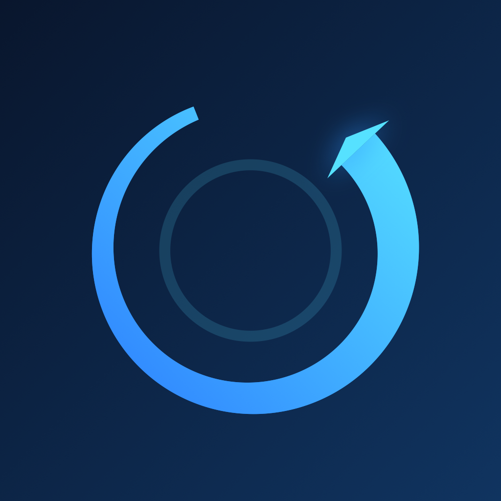

# AIRSTEP Bridge

Turns an **XSONIC AIRSTEP Spk Edition** foot controller into a general-purpose MIDI
controller for macOS, iPadOS and iOS — with no Spark amp involved and no Bluetooth
HID pairing.

The trick: the Mac or iPad **pretends to be a Positive Grid Spark 40 amp** over
Bluetooth LE. The pedal, running its stock firmware in its normal Mode 1, connects
as if it had found its amp and reports every footswitch press. Those presses are
decoded and re-emitted on a virtual CoreMIDI source named `AIRSTEP Bridge`, which
any DAW or looper can subscribe to.



## Why this exists

I own an AIRSTEP Spk Edition, which is the cheap variant of XSONIC's wireless foot
controller, sold specifically to control a Positive Grid Spark amp. I wanted to use
it as a plain MIDI pedal to drive a looper — nothing exotic.

The official route is the pedal's **Looper Mode**, which is supposed to present
itself as a Bluetooth HID keyboard that you pair in your computer's Bluetooth
settings. On my setup it never worked: the pedal simply never appeared as a
pairable device. Repeated BLE scans found the amp, found every light bulb in the
flat, and never found the pedal advertising an HID service. There is no
pairing-reset procedure on the AIRSTEP either, and its own documentation lists the
computer path as supported on macOS 10.5–10.14, which is a while ago now.

Other dead ends along the way:

- **Cross-flashing the firmware.** XSONIC's updater offers a "AIRSTEP Multi/Lite"
  firmware, and the vendor documents flashing *between* editions as reversible. The
  Spk hardware is a Nordic nRF5x running Secure DFU, so an image it does not accept
  is simply refused rather than bricking anything — but this got nowhere useful.
- **Reading the updater's API** to fetch firmware directly. The endpoint
  (`/updater/dfu_file`) rejects every request shape I tried; it evidently needs a
  header I could not reconstruct from the app binary.
- **Intercepting the app's traffic** with a proxy, which fails because Flutter's
  Dart runtime ignores the system HTTP proxy.

So instead of fighting the pedal, this reverses the roles. The pedal is completely
reliable at exactly one thing — talking to a Spark amp — so we let it do that, and
pretend to be the amp.

## ⚠️ This is 100 % AI-generated

Every line of code, the icon, this README, and the entire reverse-engineering of the
Spark BLE protocol were produced by **Claude (Anthropic)** in a single conversation.
I did not write or edit any of it by hand. My contribution was describing what I
wanted, stomping on footswitches when asked, and telling it which switch I had
actually pressed.

That last part mattered more than it sounds: the protocol reports the *resulting amp
state*, not which switch was pressed, so the mapping could only be established by
labelling real captures by hand. Several intermediate conclusions were wrong before
that and had to be corrected.

Treat the code accordingly. It works on my hardware and is documented honestly,
including its limitations — but it has had no human review.

## Build

Requires Xcode and [XcodeGen](https://github.com/yonaskolb/XcodeGen)
(`brew install xcodegen`). The `.xcodeproj` is generated, not checked in.

```sh
./build.sh              # generates the project, builds the Mac app
./build.sh --install    # also copies it to /Applications
```

**For iPhone/iPad:**

```sh
DEVELOPMENT_TEAM=ABCDE12345 ./build.sh --ios
```

Or open `AirstepBridge.xcodeproj`, select the **AirstepBridge-iOS** scheme and your
device, and Run — Xcode asks you to pick a signing team the first time. No team is
hardcoded in the repo.

## Usage

1. Turn the real Spark amp **off** — otherwise the pedal connects to it instead.
2. Start AIRSTEP Bridge.
3. Power on the AIRSTEP holding footswitch **A** to force **Mode 1**.
4. The status dot goes green when the pedal connects. Pads light up on each press.
5. Subscribe to the `AIRSTEP Bridge` MIDI source in your looper and MIDI-learn.

Per switch you can configure message type (Note / CC / Program Change), number,
channel, and whether CC should follow the pedal's on/off state. Settings persist in
`UserDefaults`.

### Switch E as a state indicator

E is the pedal's drive toggle, so unlike A–D it carries an on/off state that the
pedal tracks itself and shows on its footswitch LED. Enabling **"Getrennte
Nachrichten für an/aus"** sends on and off as two different message numbers, letting
a looper bind them to separate actions — Play on one, Pause on the other. The LED on
the pedal then doubles as a playback indicator.

Caveat: the state belongs to the pedal. Pause from the app's UI instead of the pedal
and the LED will be out of step until the next press.

### Start / stop and background operation on iOS

On iPhone and iPad the bridge has an explicit **Start / Stop** button; on the Mac it
simply always runs, because macOS does not suspend it.

While started, the app holds a silent `AVAudioSession` and disables the idle timer.
That is what actually keeps it alive in the background — the `bluetooth-peripheral`
background mode on its own is not enough, and iOS suspends the app after a few
minutes, taking the pedal connection with it. Interruptions, route changes and
engine reconfigurations are observed and the session is rebuilt, since any of those
would otherwise silently end the keep-alive.

Stop releases all of it: advertising ends, services are removed, the audio session
is deactivated and the screen may sleep again. Nothing runs in the background when
you are done.

One limitation remains: **iOS strips backgrounded BLE advertising.** The local name
is dropped and the service UUID moves to an overflow area only Apple centrals read,
so the AIRSTEP cannot *discover* the app while it is backgrounded. An established
connection is unaffected — but if it does drop, foreground the app briefly so the
pedal can find it again.

## Protocol notes

Reverse-engineered from the pedal's traffic, cross-checked against
[stangreg/Ignitron](https://github.com/stangreg/Ignitron) — which does the opposite
job on an ESP32 and was invaluable for the service UUIDs — and verified against
captures labelled by hand with the switch actually pressed.

BLE service and characteristics of the Spark amp:

| UUID | Role |
|------|------|
| `FFC0` | Spark service |
| `FFC1` | write — client → amp |
| `FFC2` | notify — amp → client |

Frame layout:

```
01 fe 00 00 53 fe <len> 00*9              16-byte block header
f0 01 <seq> <chk> <cmd> <sub> <payload> f7
```

The payload is 7-bit packed: groups of 8 bytes where the first byte carries the high
bit of the following 7.

### Mode 1 mapping

| Switch | Frame | Meaning |
|--------|-------|---------|
| A | `01 38` … `00` | hardware preset 0 |
| B | `01 38` … `01` | hardware preset 1 |
| C | `01 38` … `02` | hardware preset 2 |
| D | `01 38` … `03` | hardware preset 3 |
| E | `01 15` + `"Booster"` | drive on/off |

The effect on/off flag is the last `0x43` (on) / `0x42` (off) in the packed payload.
It sits after the effect name, so a `B`/`C` inside the name cannot be mistaken for
it.

### Things worth knowing

- **The pedal reports amp state, not switch identity.** `01 38` carries the
  *resulting* preset, so a switch with a relative function (Channel ± in Mode 2/3)
  emits a different value on every press. Only Mode 1 gives stable per-switch
  triggers. This cost several wrong conclusions before it was pinned down.
- **Handshake queries are ignored.** On connect the pedal asks `02 10` (current
  preset number) and `02 01` (current preset). Not answering costs nothing for
  presets, but the pedal then does not know which effect model is loaded — in other
  modes one press of an effect switch produces an `01 15` for *every* model in that
  family, around 14 frames. Mode 1 sends a single frame per press. Bursts are
  coalesced within 300 ms regardless.
- **`03 00 00 00 4x`** frames are a chunk counter, not input. Ignored.
- The pedal reconnects on its own after the app restarts.

## Layout

```
project.yml                            XcodeGen spec, macOS + iOS targets
Sources/Shared/AirstepBridgeApp.swift  @main entry point
Sources/Shared/Bridge.swift            BLE peripheral, Spark handling, MIDI output
Sources/Shared/decode.swift            Spark frame parsing and classification
Sources/Shared/Settings.swift          per-switch config, persisted
Sources/Shared/ContentView.swift       UI, adapts between macOS and iOS
Tools/makeicon.swift                   icon, drawn with CoreGraphics
Tools/makeicons.sh                     renders it into the asset catalog
build.sh                               generate + build + optional install
```

The five source files are shared by both targets; the handful of platform
differences sit behind `#if os(iOS)`.

## Icon

Drawn programmatically rather than shipped as an opaque bitmap, so it stays
reproducible and tweakable:

```sh
./Tools/makeicons.sh
```

That renders `Tools/makeicon.swift` and fills
`Resources/Assets.xcassets/AppIcon.appiconset` — full-bleed for iOS, squircle with
the standard inset for macOS. The PNGs are checked in, so a normal build does not
need this step.

## Status

Works on my hardware: an AIRSTEP Spk Edition (the 99 USD one) driving Loopy on
macOS 27. Only **Mode 1** is supported, which is deliberate — it is the only mode
whose switches send absolute, stable values.

Not affiliated with XSONIC or Positive Grid.

## License

[MIT](LICENSE).
